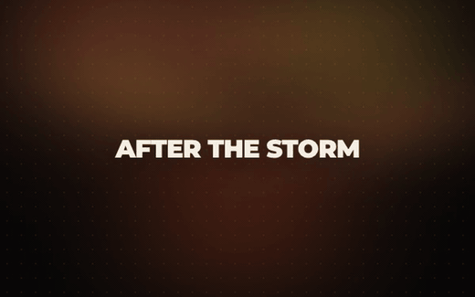
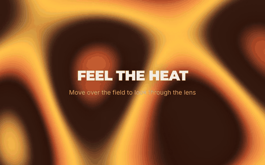
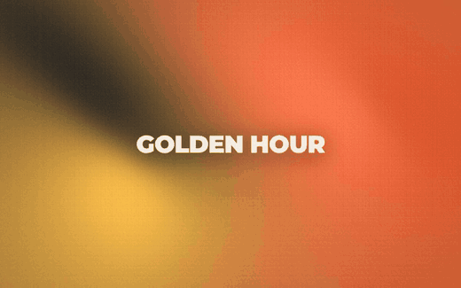
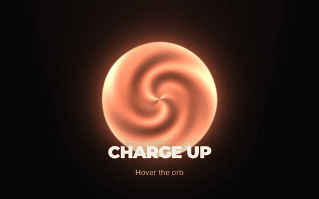
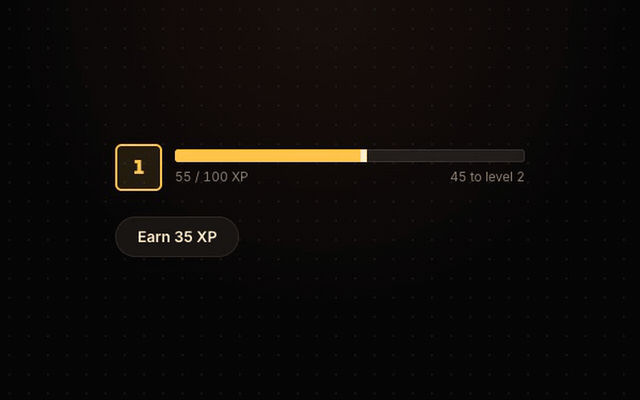
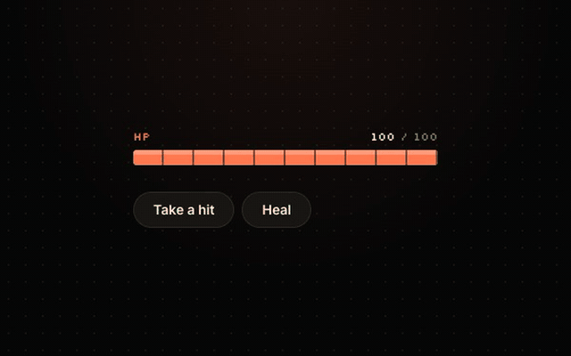
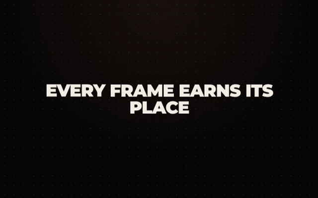
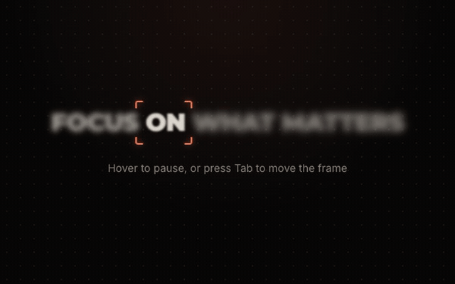

# Mekai UI

48 free animated React components for apps, landing pages and games: text effects, backgrounds, app UI, forms and game UI. Built with TypeScript, Tailwind CSS 4 and Motion by [Mekai Games](https://mekaigames.com).

**[Browse them with live previews and prop controls on ui.mekaigames.com](https://ui.mekaigames.com/components)**

<table>
  <tr>
    <td width="50%"><a href="https://ui.mekaigames.com/components/aurora"></a><br><b>Aurora</b></td>
    <td width="50%"><a href="https://ui.mekaigames.com/components/plasma"></a><br><b>Plasma</b></td>
  </tr>
  <tr>
    <td width="50%"><a href="https://ui.mekaigames.com/components/grainient"></a><br><b>Grainient</b></td>
    <td width="50%"><a href="https://ui.mekaigames.com/components/orb"></a><br><b>Orb</b></td>
  </tr>
  <tr>
    <td width="50%"><a href="https://ui.mekaigames.com/components/xp-bar"></a><br><b>XP Bar</b></td>
    <td width="50%"><a href="https://ui.mekaigames.com/components/health-bar"></a><br><b>Health Bar</b></td>
  </tr>
  <tr>
    <td width="50%"><a href="https://ui.mekaigames.com/components/blur-text"></a><br><b>Blur Text</b></td>
    <td width="50%"><a href="https://ui.mekaigames.com/components/true-focus"></a><br><b>True Focus</b></td>
  </tr>
</table>

## Install

Mekai UI works in any React 19 project with Tailwind CSS 4: Next.js, Vite, React Router and others.

With the [shadcn CLI](https://ui.shadcn.com/docs/cli), add a component by its URL. Swap `xp-bar` for any install name in the tables below:

```bash
npx shadcn@latest add https://ui.mekaigames.com/r/xp-bar.json
```

The CLI installs the dependencies (usually just `motion`), adds the Mekai theme to your CSS and writes the file to `components/ui`. Then:

```tsx
import { XpBar } from "@/components/ui/xp-bar";

<XpBar xp={240} perLevel={100} />
```

Without the CLI: install `motion`, copy the component from [`components/ui`](components/ui) and import [`theme.css`](theme.css) right after `@import "tailwindcss";` in your global CSS.

The display font is Montserrat and the pixel font is Silkscreen. Load them however your project loads fonts, or change `--font-display` and `--font-pixel` in the theme.

## Components

### Text Animations

| Component | What it does | Install name |
| --- | --- | --- |
| [Scramble Text](https://ui.mekaigames.com/components/scramble-text) | Text that decodes from random glyphs, left to right, on hover or focus. | `scramble-text` |
| [Blur Text](https://ui.mekaigames.com/components/blur-text) | Words that sharpen out of a blur, one after another, when the text scrolls into view. | `blur-text` |
| [Split Text](https://ui.mekaigames.com/components/split-text) | Letters that spring into place one by one when the text scrolls into view. | `split-text` |
| [Shiny Text](https://ui.mekaigames.com/components/shiny-text) | Text with a soft band of light that sweeps across it on a loop. | `shiny-text` |
| [Typewriter](https://ui.mekaigames.com/components/typewriter) | Types a list of phrases one character at a time, deletes them and moves on, with a blinking caret. | `typewriter` |
| [Circular Text](https://ui.mekaigames.com/components/circular-text) | Text set evenly around a slowly turning ring, with a slot in the middle for an icon or logo. | `circular-text` |
| [True Focus](https://ui.mekaigames.com/components/true-focus) | A sentence where one word at a time is sharp, framed by corner brackets that glide from word to word. | `true-focus` |
| [Echo Text](https://ui.mekaigames.com/components/echo-text) | A headline with trailing copies that fade out behind it, breathe in a slow loop and swing toward the pointer. | `echo-text` |
| [Masked Reveal](https://ui.mekaigames.com/components/masked-reveal) | A multi-line heading whose lines slide up from behind a mask, then an accent line draws in underneath. | `masked-reveal` |
| [Stroke Text](https://ui.mekaigames.com/components/stroke-text) | Outlined text that fills with color on hover or focus, sweeping in from the left, the bottom or the center. | `stroke-text` |

### Animations

| Component | What it does | Install name |
| --- | --- | --- |
| [Magnetic Button](https://ui.mekaigames.com/components/magnetic-button) | A call to action that leans toward the pointer and springs back when it leaves. | `magnetic-button` |
| [Tilt Card](https://ui.mekaigames.com/components/tilt-card) | A card that tilts in 3D toward the pointer with a moving glare, then springs back when the pointer leaves. | `tilt-card` |
| [Click Spark](https://ui.mekaigames.com/components/click-spark) | A wrapper that throws short spark lines out of every click inside it. | `click-spark` |
| [Ripple Button](https://ui.mekaigames.com/components/ripple-button) | A button whose ripple spreads from the exact point that was pressed. | `ripple-button` |
| [Logo Marquee](https://ui.mekaigames.com/components/logo-marquee) | An endless row of logos with faded edges that slows to a stop on hover. | `logo-marquee` |
| [Flip Card](https://ui.mekaigames.com/components/flip-card) | A two-sided card that turns over in 3D on hover or click to show its back. | `flip-card` |
| [Glare Hover](https://ui.mekaigames.com/components/glare-hover) | A wrapper that sweeps a band of light across its content on hover and on keyboard focus. | `glare-hover` |
| [Reveal](https://ui.mekaigames.com/components/reveal) | A wrapper that fades, slides, unblurs or scales its content in as it scrolls into view. | `reveal` |
| [Gradual Blur](https://ui.mekaigames.com/components/gradual-blur) | A scroll area whose edge melts into a progressive blur that clears when you reach the end. | `gradual-blur` |
| [Orbit](https://ui.mekaigames.com/components/orbit) | Items circling a center on one or more rings, staying upright and showing labels on hover. | `orbit` |

### Backgrounds

| Component | What it does | Install name |
| --- | --- | --- |
| [Aurora](https://ui.mekaigames.com/components/aurora) | Soft blurred color blobs that drift slowly in two layers, like warm northern lights. | `aurora` |
| [Dot Grid](https://ui.mekaigames.com/components/dot-grid) | A canvas dot grid where ripples travel out from the pointer, and from random spots when it is idle. | `dot-grid` |
| [Meteors](https://ui.mekaigames.com/components/meteors) | Diagonal meteor streaks with glowing heads, launched at random intervals over a faint starry sky. | `meteors` |
| [Plasma](https://ui.mekaigames.com/components/plasma) | A flowing plasma color field that the pointer warps like a lens. | `plasma` |
| [Grainient](https://ui.mekaigames.com/components/grainient) | A grainy gradient mesh of up to four colors that slowly morph, with a seed for stable compositions. | `grainient` |
| [Orb](https://ui.mekaigames.com/components/orb) | A glowing, breathing energy orb with a swirling surface that brightens and wobbles under the pointer. | `orb` |
| [Magnet Lines](https://ui.mekaigames.com/components/magnet-lines) | A grid of short lines that all turn to face the pointer, and sway in a slow wave when it is away. | `magnet-lines` |

### Cards & Galleries

| Component | What it does | Install name |
| --- | --- | --- |
| [Carousel](https://ui.mekaigames.com/components/carousel) | A swipeable carousel with momentum snapping, a focused center slide and screen reader announcements. | `carousel` |
| [Bounce Cards](https://ui.mekaigames.com/components/bounce-cards) | A fanned hand of cards that bounces in, then lifts a card and pushes its neighbors aside on hover or focus. | `bounce-cards` |
| [Expand Gallery](https://ui.mekaigames.com/components/expand-gallery) | A row of tall panels where the hovered or focused one widens to show its title and caption. | `expand-gallery` |
| [Glass Card](https://ui.mekaigames.com/components/glass-card) | A frosted glass card with a lit rim and a soft shine that follows the pointer, with a solid fallback where blur isn't supported. | `glass-card` |

### App UI

| Component | What it does | Install name |
| --- | --- | --- |
| [Animated Tabs](https://ui.mekaigames.com/components/animated-tabs) | Tabs with a sliding indicator, panels that follow its direction and full keyboard support. | `animated-tabs` |
| [Segmented Control](https://ui.mekaigames.com/components/segmented-control) | A compact single-choice control whose thumb slides to the selected option. | `segmented-control` |
| [Dialog](https://ui.mekaigames.com/components/dialog) | An accessible modal that springs in over a blurred backdrop and hands focus back on close. | `dialog` |
| [Accordion](https://ui.mekaigames.com/components/accordion) | Sections that open with an animated height, one at a time or several together. | `accordion` |
| [Animated Tooltip](https://ui.mekaigames.com/components/animated-tooltip) | A tooltip that springs out of its trigger, leans toward the pointer and shows on focus too. | `animated-tooltip` |
| [Avatar Stack](https://ui.mekaigames.com/components/avatar-stack) | Overlapping avatars that fan out with names on hover, plus a bubble for the rest. | `avatar-stack` |
| [Pill Nav](https://ui.mekaigames.com/components/pill-nav) | A pill navbar where the active pill slides between links and a softer pill previews where you point. | `pill-nav` |
| [Animated List](https://ui.mekaigames.com/components/animated-list) | A scrollable list whose rows pop in as they appear, with keyboard selection and edge fades. | `animated-list` |
| [Rolling Counter](https://ui.mekaigames.com/components/rolling-counter) | An odometer counter whose digits roll the shortest way, with separators, decimals and negatives. | `rolling-counter` |
| [Folder](https://ui.mekaigames.com/components/folder) | A folder button that opens on hover or click and fans out papers that lean toward the pointer. | `folder` |

### Forms & Inputs

| Component | What it does | Install name |
| --- | --- | --- |
| [Toggle Switch](https://ui.mekaigames.com/components/toggle-switch) | A switch whose knob rides a spring and stretches with its own speed. | `toggle-switch` |
| [Floating Input](https://ui.mekaigames.com/components/floating-input) | A text field whose label floats up on focus, with an underline that grows from the center and an error that shakes. | `floating-input` |
| [Animated Checkbox](https://ui.mekaigames.com/components/animated-checkbox) | A checkbox that pops when checked and draws its tick, with an indeterminate dash for partial selections. | `animated-checkbox` |
| [Star Rating](https://ui.mekaigames.com/components/star-rating) | Stars that fill in a stagger on hover, pop on click and follow the arrow keys. | `star-rating` |

### Game UI

| Component | What it does | Install name |
| --- | --- | --- |
| [XP Bar](https://ui.mekaigames.com/components/xp-bar) | A level badge and a spring-filled progress bar that bursts when the player levels up. | `xp-bar` |
| [Pixel Button](https://ui.mekaigames.com/components/pixel-button) | A chunky 8-bit button with a hard shadow that physically presses down. | `pixel-button` |
| [Health Bar](https://ui.mekaigames.com/components/health-bar) | An HP bar that drops instantly on a hit while a lighter chip bar trails behind, and glows on heal. | `health-bar` |

## More components

Mekai UI Pro adds 66 more components, including Silk, Liquid Chrome, Leaderboard, Streak and Loot Reveal: €39 once for one developer or €199 for a team of up to 10, with every future component included. [See Pro](https://ui.mekaigames.com/pro).

## Guides

- [Animated hero backgrounds in Next.js](https://ui.mekaigames.com/guides/animated-hero-background-nextjs)
- [Gamification UI in React](https://ui.mekaigames.com/guides/gamification-ui-react)
- [Respecting prefers-reduced-motion in React](https://ui.mekaigames.com/guides/reduced-motion-react)
- [All guides](https://ui.mekaigames.com/guides)

## Feedback

Found a bug or want a component? [Open an issue](https://github.com/mekai-ui/mekai-ui/issues) or write to mekai.official.games@gmail.com.

## License

[MIT](LICENSE), free for personal and commercial projects.
